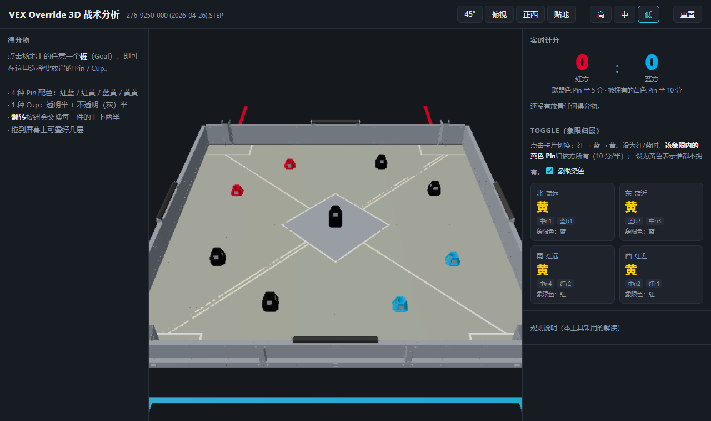
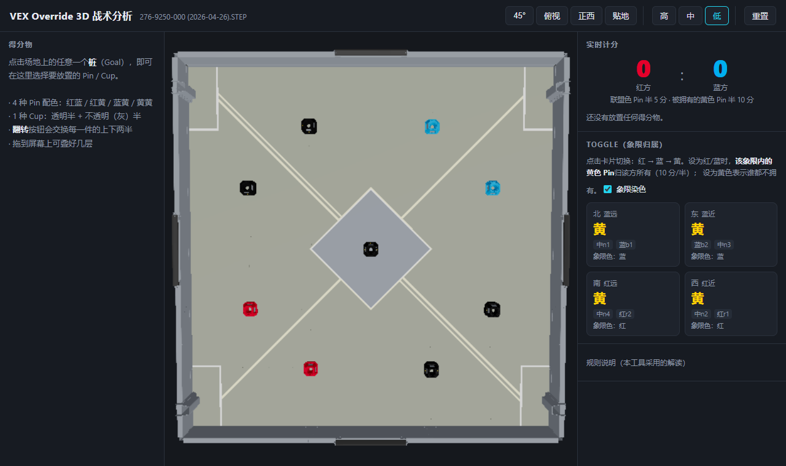
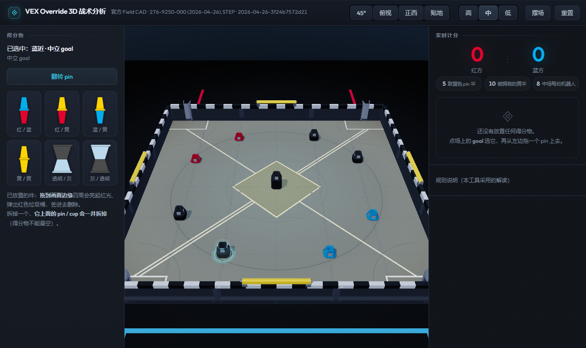
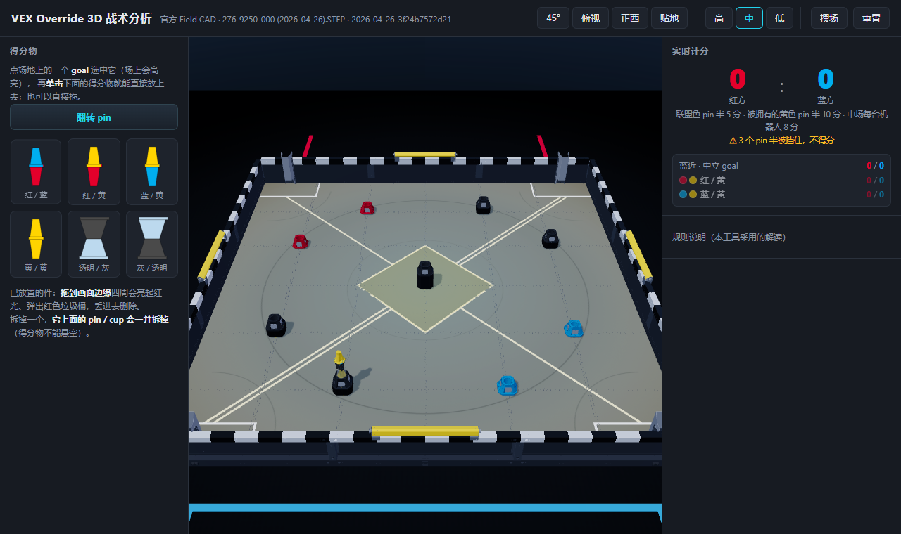
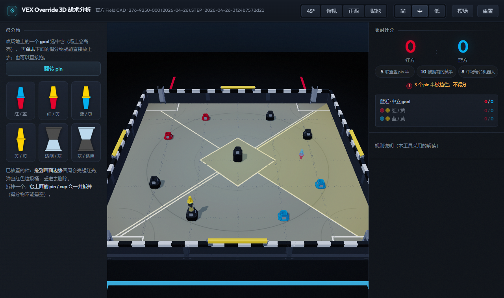
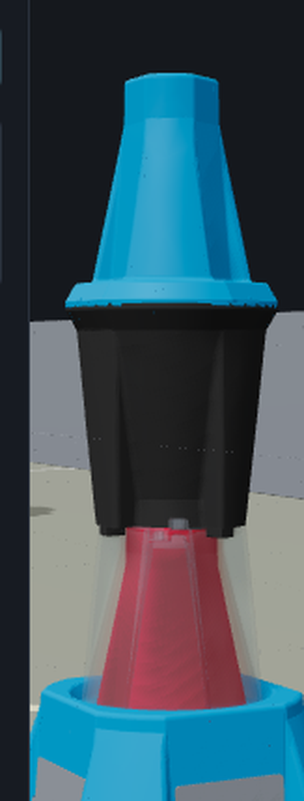

# VEX3D — VEX V5「Override」3D 战术分析演示器

[](https://github.com/JiHuiYiYou/VEX3D/actions/workflows/ci.yml)
[](LICENSE)

在浏览器里摆弄 2026-2027 **Override** 赛季的得分物，实时算分。



> 3D 场地用的是 VEX 官网下载的官方 Field CAD 转出来的几何，不是手搓的方块。
> 比分逻辑严格按官方 Game Manual v0.1（中英对照）实现。

| | |
|---|---|
|  |  |
| 俯视：9 个桩、4 个围栏 Toggle、4 个 Loader、中场菱形、对角自动线 | 点桩 → 左侧出现 4 种 Pin + 1 种 Cup，外加一个「翻转」按钮 |
|  |  |
| Pin / Cup 可以一层层往上叠 | 拖动已放好的件到画面边缘：四周亮起红光、弹出红色垃圾桶 |

拖动过程中四周已经有淡淡的红晕，越靠近边缘越亮：





上图是一个 **Pin → Cup → Pin** 的摞（近景）。**Cup 的下半（透明）罩着下面那个 Pin 的上半**，
所以红色透过它看得见；**Cup 的上半（灰）罩着上面那个 Pin 的下半**，
蓝色那一半就被挡住了（计分板上打叉）。

## 能做什么

- **真实场地** —— 直接用官方 Field CAD
  （`fieldcad/276-9250-000 (2026-04-26).STEP`）转出来的几何：12 ft × 12 ft，
  9 个 Goal、4 个 Toggle、4 个 Loader、中场菱形、对角胶带、红蓝角区、格纹围栏。
  Goal 的高度、socket 孔径、Pin/Cup 半体尺寸全部是 CAD 实测值（与手册差 < 0.1 mm）。
- **点击桩 → 左侧调色板** —— 4 种 Pin（红蓝 / 红黄 / 蓝黄 / 黄黄）+ 1 种 Cup（透明 / 灰），
  一个**翻转**按钮交换每一件的上下两半。
- **两种件的形状不一样**（CAD 装配树实测）：**Pin = 翻边对翻边的线轴**，
  **Cup = 杯口对杯口的沙漏**（两端敞口宽沿、中间 Ø59 细腰）。
  叠放时是真的**套进去**的 —— Cup 的下半是薄壁套筒，罩着 Pin 的上半锥体，
  Pin 的尖端正好探进 Cup 的腰（杯口）。
- **叠放规则** —— **Pin 只能放在 Cup 上或直接放在桩上，Cup 只能放在 Pin 上**；
  其它组合算非法，直接拒绝并给一句中文提示。
- **删除手势** —— 拖动已放好的件，**画面四周会亮起红光**；越靠近边缘越亮，
  最近那条边中央弹出**红色垃圾桶**，丢进去即删。
- **实时计分板** —— 联盟色端子 5 分、被拥有的黄色端子 10 分；
  hover 任意端子能看到**本次判定的理由**（方便对着官方 Q&A 核对）。
- **Toggle 切换** —— 4 个 Toggle 循环 **红 → 蓝 → 黄**（手册 `<SC4>` 只承认这三个有效朝向），
  黄色 Pin 的归属实时跟着变。象限用**场地方向**命名：
  **西 = 红近、南 = 红远、东 = 蓝近、北 = 蓝远**。
- **象限染色** —— 每个象限按它那个 Toggle 的当前状态染色，一眼看出这个象限的黄色 Pin 归谁
  （Toggle 面板里可开关，鼠标悬停某张卡片会加深那个象限）。
- **相机** —— 左键旋转 / 右键平移 / 滚轮缩放，顶栏有 45° / 俯视 / 正西 / 贴地 四个预设；
  **默认视角朝西看**（相机在东侧，画面左 = 南、右 = 北）。
- **画质档位**（高 / 中 / 低）—— 关阴影、降像素比、关抗锯齿。弱机器或投影仪上调一档就流畅。

## 跑起来

```bash
npm install
npm run dev        # http://127.0.0.1:5173
npm test           # 计分引擎回归测试（17 个场景 + 摆放合法性）
npm run build      # 产物在 dist/
```

机器吃力时可以在网址后面加 `?quality=low`（关阴影、降像素比）。

> **克隆下来能跑，但没有 CAD 场地。** 转换出来的资产（`public/assets/`，约 20 MB）不入库，
> 所以新克隆的仓库用的是**程序化兜底场地**：桩位、socket、半体尺寸和 CAD 实测值一致（这些
> 硬编码在 `src/data/fieldSpec.ts` 里），但围栏、地砖、Loader、Toggle 都是简化的几何，
> 没有官方零件的细节。要完整场地请按下一节自己生成一份。

## 重新生成 CAD 资产

```bash
# 1. 首次：解析 126 MB STEP 并缓存（约 8 分钟，峰值约 2 GB 内存）
tools/.venv/Scripts/python.exe tools/build_cache.py

# 2. 出资产（约 15 秒）
tools/.venv/Scripts/python.exe tools/extract_field.py --with-wall-trim

# 3. 交叉校验
tools/.venv/Scripts/python.exe tools/validate_assets.py
```

产物在 `public/assets/`（不入库）。管线细节见 [`tools/README.md`](tools/README.md)。

## 项目结构

```
src/
  data/fieldSpec.ts   场地规格 + 坐标系换算 + 兜底几何
  state/scoring.ts    ★ 计分引擎（全部规则逻辑都在这一个文件里）
  state/store.ts      zustand store
  state/drag.ts       拖拽指针状态（放在 React 之外，避免每帧重渲染）
  scene/stackLayout.ts ★ 堆叠几何：半体摆放 + 嵌套落点（3D / 幽灵件 / 测试共用）
  scene/              R3F 场景：场地 / Goal / 得分物 / Toggle / 象限染色 / 拖拽幽灵件
  ui/                 左侧调色板、计分板、Toggle 面板、规则说明、垃圾桶
tools/                离线 Python 管线（OCP）+ 验证脚本
docs/                 README 用的截图
```

`CLAUDE.md` 是给 AI / 维护者看的详细说明：坐标系约定、CAD 实测数据、
踩过的坑、还没解决的问题。

## 开发脚本

| 命令 | 作用 |
|---|---|
| `npm run dev` | 开发服务器（Vite） |
| `npm run build` | `tsc -b` + 生产构建 → `dist/` |
| `npm run preview` | 预览 `dist/` |
| `npm test` | 计分引擎回归测试（Node 直接跑 `.ts`，需要 Node 22.18+ / 24） |
| `npm run typecheck` | 只做类型检查 |
| `C:/.../miniconda3/python.exe tools/verify_ui.py` | Playwright 端到端验证（29 项断言 + 截图） |
| `C:/.../miniconda3/python.exe tools/shot_stack.py` | 拍一张 Pin/Cup 嵌套特写（肉眼核对用） |

### 可选：接上 VEX 规则查询 MCP

装 [VEXmcp](https://github.com/JiHuiYiYou/VEXmcp) 之后，在仓库根目录建一个 `.mcp.json`
（**不入库**，里面的绝对路径换台机器就没用）：

```json
{
  "mcpServers": {
    "vex-api": {
      "command": "<你的 python>",
      "args": ["<VEXmcp 目录>/server.py"]
    }
  }
}
```

## 规则依据

计分严格按官方 Game Manual v0.1（中英文对照）实现，核心几条：

- `<SC2>` Pin 与 Goal 嵌套、或与「一个已 placed 的 Pin 啮合的 Cup」嵌套，才算 placed；
  同一个 Cup 半体里最多放 1 个 Pin。
- `<SC3>` 端子嵌在 **透明** 杯半体里、或 **未被 Cup 覆盖** 时计分；
  被不透明（灰）杯挡住不计分。一个 placed 的 Pin 有 1 个或 2 个得分端子。
- **罩住关系**（CAD 实测 + 手册图 SC5-1/2）：Cup 的**下半**罩住它**下面**那个 Pin 的**上半**；
  Cup 的**上半**罩住它**上面**那个 Pin 的**下半**。Goal 不是 Cup，不挡分。
- `<SC3> a/b/c` 按**端子自身颜色**判联盟：红 → 红方、蓝 → 蓝方、黄 → 拥有方。
  联盟桩的颜色**不改变**端子的归属。
- `<SC4>` Toggle 只有 **红 / 蓝 / 黄** 三个有效朝向；黄色表示谁都不拥有。
- `<SC5>` 象限内的黄色 Pin 归该象限 Toggle；中场高桩里的黄色 Pin 归中场机器人多的一方。

全部规则逻辑集中在 [`src/state/scoring.ts`](src/state/scoring.ts) 一个文件里，
每个判定都带一句 `reason`，直接显示在计分板上 —— 官方 Q&A 更新时只改这一处。

## License

[MIT](LICENSE) © 2026 JiHuiYiYou

场地图纸来自 VEX 官方 Field CAD，`fieldcad/` 下的原始 STEP 文件**不随本仓库分发**。
