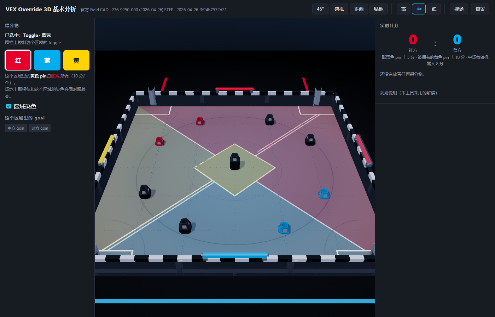
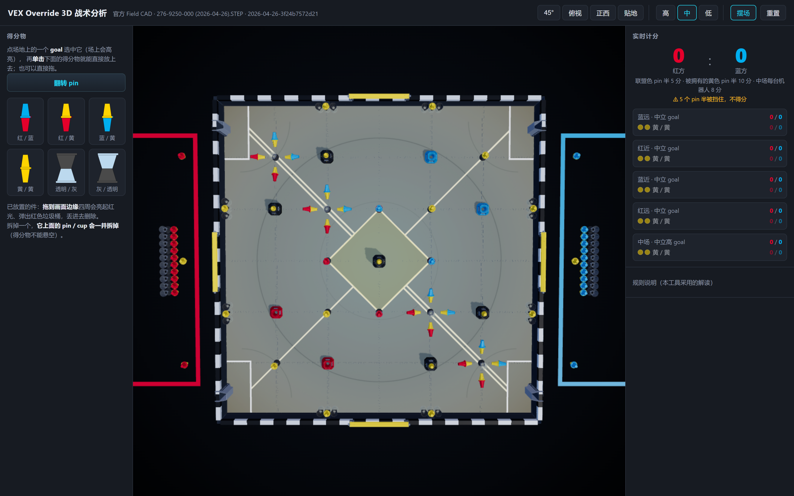
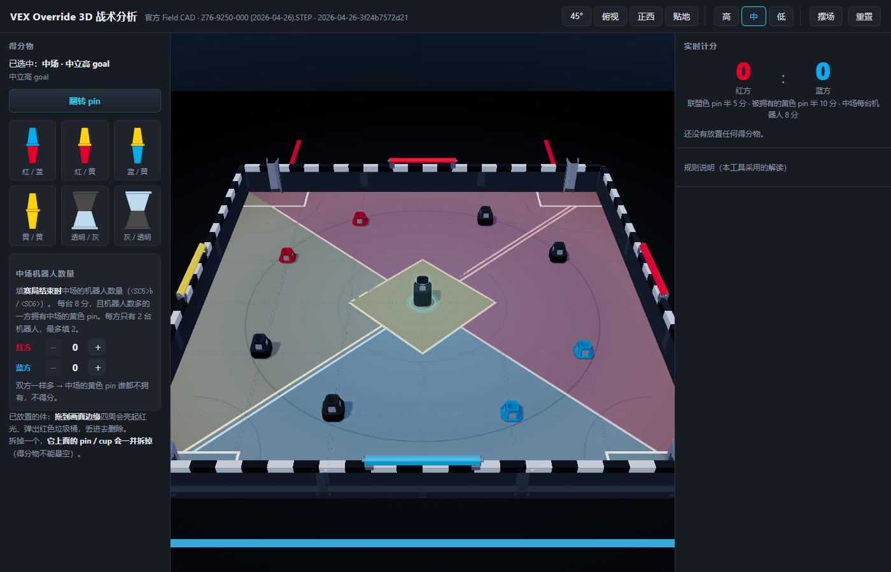

# VEX3D — VEX V5「Override」3D 战术分析演示器

[](https://github.com/JiHuiYiYou/VEX3D/actions/workflows/ci.yml)
[](LICENSE)

在浏览器里摆弄 2026-2027 **Override** 赛季的得分物，实时算分。


> 3D 场地用的是 VEX 官网下载的官方 Field CAD 转出来的几何，不是手搓的方块。
> 比分逻辑严格按官方 Game Manual v0.1（中英对照）实现。

| | |
|---|---|
|  |  |
| 俯视：9 个 goal、4 个围栏 toggle、4 个 Loader、中场菱形、对角自动线 | 点 goal → 左侧出现 4 种 pin + 正反 2 个 cup |
|  |  |
| pin / cup 可以一层层往上叠 | 拖动已放好的件到画面边缘：四周亮起红光、弹出红色垃圾桶 |

拖动过程中四周已经有淡淡的红晕，越靠近边缘越亮：




**点围栏上的 toggle** → 左侧弹出它的设置（红 / 蓝 / 黄）。场地上那根条和对应区域的染色
会**同时**跟着变 —— 哪个区域归谁，一眼就看得出。



**「摆场」** 一键把场地摆成**官方开局布局**：4 个中立 goal + 中场 goal 各插一根黄/黄 pin，
场地上 16 个落位的 (cup + 插在 cup 里的 pin)、四面墙各 2 组 (cup, pin, cup)、
4 个斜角落位周围各躺着 4 根 pin，还有红/蓝双方的装填区（各 10 组 cup + pin）。
这些坐标直接来自**官方 Field CAD** 里那 63 根 pin + 56 个 cup 的摆法，
跟官方 VEXcode VR Playground 的 **GPS 坐标表**（20 个落位，误差 ≤ 5.5 mm）和
**得分物清单**（场上 37 pin + 36 cup，装填区 26 pin + 20 cup，配色数量全对）逐项吻合 ✓。
散件也能拖着挪位置、拖到边缘删掉。


上图是一个 **pin → cup → pin** 的摞（近景）。**cup 的下半（透明）罩着下面那个 pin 的上半**，
所以红色透过它看得见；**cup 的上半（灰）罩着上面那个 pin 的下半**，
蓝色那一半就被挡住了（计分板上打叉）。

## 能做什么

- **真实场地** —— 直接用官方 Field CAD
  （`fieldcad/276-9250-000 (2026-04-26).STEP`）转出来的几何：12 ft × 12 ft，
  9 个 goal、4 个 toggle、4 个 Loader、中场菱形、对角胶带、红蓝角区、格纹围栏。
  goal 的高度、socket 孔径、pin/cup 半体尺寸全部是 CAD 实测值（与手册差 < 0.1 mm）。
  **场地的几何只有这一份来源**：资产缺了就报错，不拿手搓的近似几何顶替。
- **配色和质感另做一层** —— CAD 导出既没有材质也没有 UV，所以颜色 / 贴图 / 光照都是前端画的：
  垫子是程序生成的印刷贴图（冷暖分层 + 竞技场大圆 + 颗粒），围栏顶那条压条是按世界坐标
  画的黑白条纹，灯光是「暖主光 + 冷补光 + 环境贴图」，所以画面有明暗和冷暖，
  不是一片均匀的灰。
- **点 goal → 左侧调色板** —— **4 种 pin**（红蓝 / 红黄 / 蓝黄 / 黄黄）+
  **正反 2 个 cup**（透明在下 / 灰在下）。cup 的朝向决定它用哪一半罩住谁，
  所以直接给两个选项摆件，**不用再按「翻转」**；「翻转 pin」按钮只用来对调 pin 的上下两半。
- **两种放法** —— 把左边的得分物**拖**到场上任意一个 goal；或者先点中一个 goal
  （场上会亮起青色环 + 一柱光，摞顶还有个落点环），再**单击**左边的得分物 → 直接落在它上面。
  两种放法都守同一套叠放规则。
- **摆场 / 重置** —— 顶栏「摆场」按**官方开局布局**摆好全场（坐标来自官方 Field CAD，
  与官方 VEXcode VR Playground 的 GPS 表和得分物清单逐项吻合）；「重置」全部清空。
- **两种件的形状不一样**（CAD 装配树实测）：**pin = 翻边对翻边的线轴**，
  **cup = 杯口对杯口的沙漏**（两端敞口宽沿、中间 Ø59 细腰）。
  叠放时是真的**套进去**的 —— cup 的下半是薄壁套筒，罩着 pin 的上半锥体，
  pin 的尖端正好探进 cup 的腰（杯口）。
- **叠放规则** —— **pin 只能放在 cup 上或直接放在 goal 上，cup 只能放在 pin 上**；
  其它组合算非法，直接拒绝并给一句中文提示。
- **得分物不能悬空** —— 拆掉一个，**它上面的 pin / cup 一并拆掉**（垃圾桶、Delete 键都这样）。
- **删除手势** —— 拖动已放好的件，**画面四周会亮起红光**；越靠近边缘越亮，
  最近那条边中央弹出**红色垃圾桶**，丢进去即删。
- **实时计分板** —— 联盟色 pin 半 5 分、被拥有的黄色 pin 半 10 分；
  hover 任意 pin 能看到**本次判定的理由**（方便对着官方 Q&A 核对）。
- **toggle 切换** —— 点场上的 toggle → 左侧选红 / 蓝 / 黄（手册 `<SC4>` 只承认这三个有效朝向），
  黄色 pin 的归属实时跟着变，**围栏上那根条和区域染色一起变**。
  四个区域叫 **红近 / 红远 / 蓝近 / 蓝远**（近/远是相对该联盟自己说的）。
- **中场的机器人数** —— 中场没有 toggle，中场的黄色 pin 归**赛局结束时中场机器人数多的一方**
  （`<SC5>b`），而且**每台位于中场的机器人给它的联队 8 分**（每方只有 2 台机器人，最多填 2）。
  选中中场的 goal 就能填这个数，
  中场那块菱形也会按谁拥有它染色：

  

- **相机** —— 左键旋转 / 右键平移 / 滚轮缩放，顶栏有 45° / 俯视 / 正西 / 贴地 四个预设；
  **默认视角朝西看**（相机在东侧，画面左 = 南、右 = 北）。
- **画质档位**（高 / 中 / 低）—— 关阴影、降像素比、关抗锯齿。弱机器或投影仪上调一档就流畅。

## 跑起来

```bash
npm install
npm run dev        # http://127.0.0.1:5173
npm test           # 计分引擎回归测试（17 个场景 + 摆放合法性）
npm run build      # 产物在 dist/
```

机器吃力时可以在网址后面加 `?quality=low`（关阴影、降像素比）。

> **克隆下来跑不起来 —— 除非先生成 CAD 资产。** 场地的几何**只有官方 Field CAD 一份来源**，
> 没有手搓的「相似版」：转换出来的资产（`public/assets/`，约 27 MB）不入库，
> 所以新克隆的仓库启动时会直接报错，并告诉你怎么生成。宁可少一个功能，也不要给你一个
> 「看着像官方场地、其实不是」的东西。

## 重新生成 CAD 资产

```bash
# 1. 首次：解析 126 MB STEP 并缓存（约 8 分钟，峰值约 2 GB 内存）
tools/.venv/Scripts/python.exe tools/build_cache.py

# 2. 出资产（约 15 秒）
tools/.venv/Scripts/python.exe tools/extract_field.py --with-wall-trim

# 3. 交叉校验
tools/.venv/Scripts/python.exe tools/validate_assets.py
```

产物在 `public/assets/`（不入库）。管线细节见 [`tools/README.md`](tools/README.md)。

## 项目结构

```
src/
  data/fieldSpec.ts   场地规格 + 坐标系换算 + CAD 实测常量
  state/scoring.ts    ★ 计分引擎（全部规则逻辑都在这一个文件里）
  state/store.ts      zustand store
  state/drag.ts       拖拽指针状态（放在 React 之外，避免每帧重渲染）
  scene/stackLayout.ts ★ 堆叠几何：半体摆放 + 嵌套落点（3D / 幽灵件 / 测试共用）
  scene/              R3F 场景：场地 / goal / 得分物 / toggle / 区域染色 / 拖拽幽灵件
  ui/                 左侧面板（调色板 / toggle 设置）、计分板、规则说明、垃圾桶
tools/                离线 Python 管线（OCP）+ 验证脚本
docs/                 README 用的截图
```

`CLAUDE.md` 是给 AI / 维护者看的详细说明：坐标系约定、CAD 实测数据、
踩过的坑、还没解决的问题。

## 开发脚本

| 命令 | 作用 |
|---|---|
| `npm run dev` | 开发服务器（Vite） |
| `npm run build` | `tsc -b` + 生产构建 → `dist/` |
| `npm run preview` | 预览 `dist/` |
| `npm test` | 计分引擎回归测试（Node 直接跑 `.ts`，需要 Node 22.18+ / 24） |
| `npm run typecheck` | 只做类型检查 |
| `C:/.../miniconda3/python.exe tools/verify_ui.py` | Playwright 端到端验证（56 项断言 + 截图） |
| `C:/.../miniconda3/python.exe tools/shot_stack.py` | 拍一张 Pin/Cup 嵌套特写（肉眼核对用） |

### 可选：接上 VEX 规则查询 MCP

装 [VEXmcp](https://github.com/JiHuiYiYou/VEXmcp) 之后，在仓库根目录建一个 `.mcp.json`
（**不入库**，里面的绝对路径换台机器就没用）：

```json
{
  "mcpServers": {
    "vex-api": {
      "command": "<你的 python>",
      "args": ["<VEXmcp 目录>/server.py"]
    }
  }
}
```

## 规则依据

计分严格按官方 Game Manual v0.1（中英文对照）实现，核心几条：

- `<SC2>` Pin 与 Goal 嵌套、或与「一个已 placed 的 Pin 啮合的 Cup」嵌套，才算 placed；
  同一个 Cup 半体里最多放 1 个 Pin。
- `<SC3>` pin 半嵌在 **透明** 杯半里、或 **未被 cup 覆盖** 时计分；
  被不透明（灰）杯挡住不计分。一个 placed 的 pin 有 1 个或 2 个得分的半。
- **罩住关系**（CAD 实测 + 手册图 SC5-1/2）：Cup 的**下半**罩住它**下面**那个 Pin 的**上半**；
  Cup 的**上半**罩住它**上面**那个 Pin 的**下半**。
- **goal 也挡分**（本工具采用的解读）：直接插在 goal 孔里的那个 pin，**下半整个埋在 socket 里 → 不计分**。
  ⚠️ 官方手册图 SC5-1/2 给的是相反的（中间板里插在 goal 里的黄半标着 +10），所以这条由
  `src/state/scoring.ts` 的 `GOAL_COVERS_PIN_LOWER` 一个常量控制，改成 `false` 即回到手册口径。
- `<SC3> a/b/c` 按**pin 半自身的颜色**判联盟：红 → 红方、蓝 → 蓝方、黄 → 拥有方。
  联盟 goal 的颜色**不改变**归属。
- `<SC4>` toggle 只有 **红 / 蓝 / 黄** 三个有效朝向；黄色表示谁都不拥有。
- `<SC5>` 区域内的黄色 pin 归该区域 toggle；中场高 goal 里的黄色 pin 归中场机器人多的一方。

全部规则逻辑集中在 [`src/state/scoring.ts`](src/state/scoring.ts) 一个文件里，
每个判定都带一句 `reason`，直接显示在计分板上 —— 官方 Q&A 更新时只改这一处。

## License

[MIT](LICENSE) © 2026 JiHuiYiYou

场地图纸来自 VEX 官方 Field CAD，`fieldcad/` 下的原始 STEP 文件**不随本仓库分发**。
